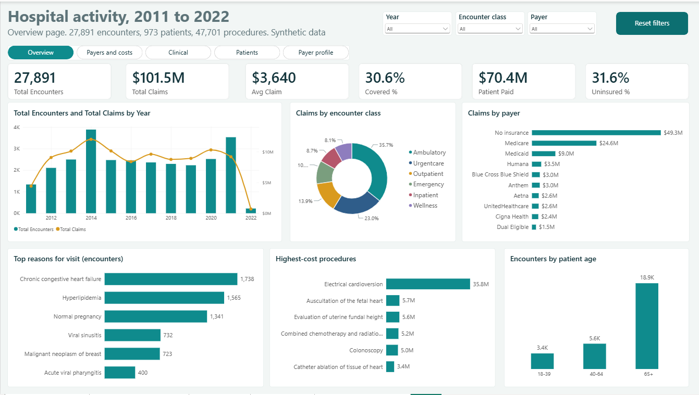
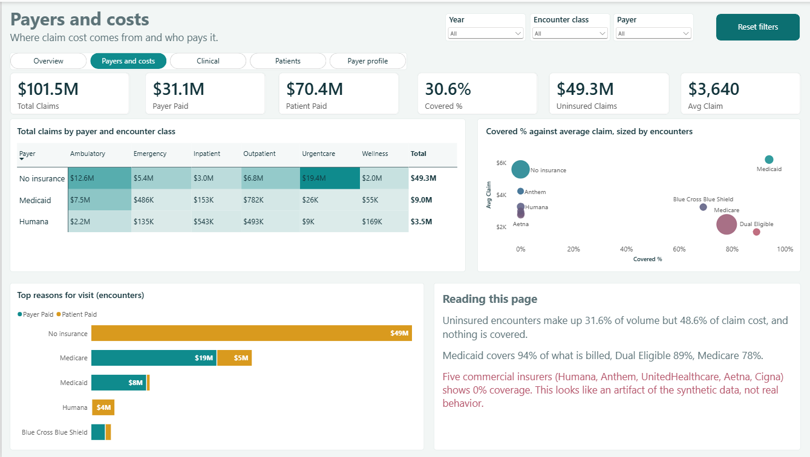
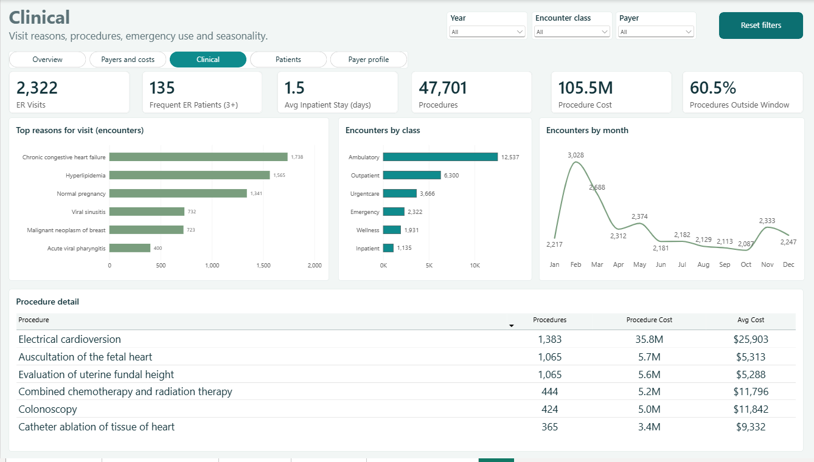
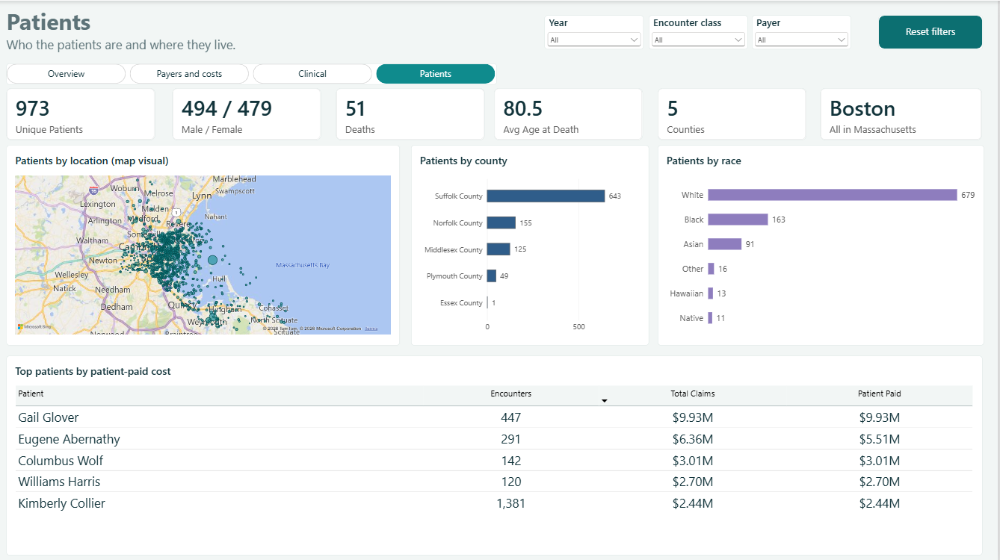

# Hospital Analytics: From a Messy SQL Dump to a Power BI Dashboard




## Table of contents

1. [Project overview](#project-overview)
2. [Business problem](#business-problem)
3. [Datasets](#datasets)
4. [Tools and technologies used](#tools-and-technologies-used)
5. [Analytical approach](#analytical-approach)
6. [Key findings](#key-findings)
7. [Business recommendations](#business-recommendations)
8. [Dashboard preview](#dashboard-preview)
9. [Files in this repository](#files-in-this-repository)
10. [About this project](#about-this-project)

---

## Project overview

This project takes a raw hospital database script, audits it for quality problems, rebuilds it as a clean relational database, and turns it into a four-page Power BI dashboard.

The data covers **27,891 hospital encounters** for **973 patients** between 2011 and early 2022, with **47,701 procedures** and about **$101.5M in claims**. The report shows how much care is delivered, what it costs, who pays for it, and who the patients are.

**Live case study:** [add your Netlify link here]

---

## Business problem

A hospital finance and operations team wants straight answers to four questions:

1. **Utilization:** how much care do we deliver, to whom, and in what setting?
2. **Cost:** where does claim cost concentrate, by visit type, procedure and reason for care?
3. **Payers:** who pays, how much of each claim do they cover, and how much falls on patients or goes uncovered?
4. **Risk:** where are the outliers and the data gaps that could mislead decisions?

The starting point was a single 18 MB SQL script with no foreign keys and several silent data problems. Any report built directly on it would have given wrong answers, so the first job was to make the data trustworthy.

---

## Datasets

The source is a single script, `hospital_db_clean_sqlite.sql`, containing synthetic hospital records in four tables.

| Table | Rows | What it holds |
|---|---|---|
| `payers` | 10 | Insurers and their headquarters details |
| `patients` | 973 | Demographics, location, birth and death dates |
| `encounters` | 27,891 | Visits: dates, class, reason, costs, payer coverage |
| `procedures` | 47,701 | Procedures done during encounters, with base cost |

After cleaning, the data is also reshaped into a star schema for Power BI:

| Table | Type | Purpose |
|---|---|---|
| `DimDate` | Dimension | Calendar, 2011 to 2022 |
| `DimPatient` | Dimension | Patient attributes, age at death, deceased flag |
| `DimPayer` | Dimension | Payers, plus a "No insurance" row |
| `FactEncounters` | Fact | One row per encounter, with age band and length of stay |
| `FactProcedures` | Fact | One row per procedure, with a time-window flag |

**Note:** the data is synthetic. Findings describe this dataset, not real patients or hospitals.

---

## Tools and technologies used

| Area | Tools |
|---|---|
| Database | SQLite, DB Browser for SQLite |
| Querying | SQL (joins, aggregation, subqueries, CASE logic) |
| Modelling and reporting | Power BI Desktop, Power Query, DAX |
| Publishing | Git, GitHub, Netlify (case study site) |

---

## Analytical approach

1. **Audit the source.** Loaded the script into a test database and checked every relationship, date and total.
2. **Rebuild the database.** Added primary keys, foreign keys, CHECK rules, lookup tables and indexes. Kept a rule: fix errors when the truth is knowable, flag them when it is not.
3. **Verify.** Ran an integrity check and a foreign-key check, with zero violations.
4. **Explore with SQL.** Wrote 14 queries on volume, cost, payer mix, age bands, visit reasons, procedures, emergency use, length of stay and mortality.
5. **Model for Power BI.** Exported a star schema and set up one-to-many relationships with `DimDate` marked as the date table.
6. **Write DAX measures.** Built about 25 measures for totals, coverage, uninsured share, time intelligence, emergency use and procedures.
7. **Design the report.** Four pages with a consistent theme, plus synced slicers, a reset button, drill-through to a payer profile, and a hover tooltip page.
8. **Document the limits.** Added a caveats text box to the report so readers know what the data can and cannot support.

---

## Key findings

- **Uninsured care drives almost half of the cost.** Uninsured patients are 31.6% of encounters but about $49.3M of the $101.5M in claims (48.6%), with nothing covered by a payer. The uninsured share of encounters stayed between 27% and 37% in every year.
- **Urgent care is the biggest exposure.** Uninsured patients account for $19.4M of the $23.3M in urgent care claims (83%).
- **Care is concentrated in older patients.** Patients 65 and over account for 18,871 of 27,891 encounters (68%).
- **Emergency use is concentrated in a few patients.** The 135 patients with three or more emergency visits account for 1,875 of the 2,322 emergency visits (81%, or 72% after excluding one outlier patient).
- **One procedure dominates procedure spend.** Electrical cardioversion costs about $35.8M, which is 34% of all procedure cost and roughly six times the next procedure.
- **Heart disease leads visits.** Congestive heart failure is the top recorded reason at 1,738 encounters, ahead of hyperlipidemia (1,565) and normal pregnancy (1,341).
- **Coverage varies widely by payer.** Medicaid covers about 94% of what it is billed, against 78% for Medicare.
- **Demand has a pattern.** Volume peaked in 2014 at 3,885 encounters, and February is the busiest month of the year (3,028 encounters across all years).
- **Patients are local.** 540 of 973 patients live in Boston, and 643 are in Suffolk County. Inpatient stays average 1.5 days.
- **Mortality:** 51 deaths, with an average age at death of 80.5.

**Data caveats:** 2022 is a partial year. Five commercial insurers (Humana, Anthem, UnitedHealthcare, Aetna and Cigna) show 0% coverage, which looks like an artifact of how the data was generated. One patient has about 200 emergency visits and a different patient has about $9.9M out of pocket. 60.5% of procedures fall outside their encounter's time window.

---

## Business recommendations

These follow from the findings above. Because the data is synthetic, treat them as an illustration of how the analysis would be used on real data.

1. **Target coverage enrollment where uninsured cost is highest.** Put financial counselling and coverage screening in urgent care and ambulatory settings first. Uninsured patients drive 83% of urgent care claims, and the uninsured share has not fallen over the period.
2. **Start a care-management programme for frequent emergency users.** A small group (135 patients) drives most emergency visits. Reviewing their needs, and offering follow-up and primary care, is likely to cut avoidable visits. Check the single 200-visit patient record first, since it may be a data error.
3. **Review the electrical cardioversion pathway.** With 34% of procedure spend, it deserves a volume, pricing and appropriateness review. Pair it with a chronic heart failure management programme, since heart failure is the leading visit reason.
4. **Plan capacity around older patients and winter demand.** With 68% of encounters from patients 65 or older and a February peak, schedule staffing and beds for that pattern.
5. **Audit payment data for commercial insurers before negotiating.** In real data, 0% coverage across five insurers would mean missing payment records or a billing failure. Confirm that first, then compare contract terms.
6. **Add data validation at the source.** Enforce keys and checks when records are loaded. This project found missing patients, missing death dates and procedures outside their visits, all of which would distort reporting.

---

## Dashboard preview

| Overview | Payers and costs |
|---|---|
|  |  |
| **Clinical** | **Patients** |
|  |  |


| Page | What it answers |
|---|---|
| Overview | How much care, how much cost, and who pays |
| Payers and costs | Claim cost by payer and class, and how much each payer covers |
| Clinical | Top visit reasons, costliest procedures, emergency use, seasonality |
| Patients | Who the patients are and where they live |

**Interactivity:** synced slicers (year, encounter class, payer), a one-click reset button, page navigator tabs, a drill-through payer profile page, a hover tooltip page, and a caveats text box on the report.

---

## Files in this repository

```
.
├── README.md
├── sql/
│   ├── create_hospital_db.sql            Original source script
│   ├── hospital_db_clean_sqlite.sql      Cleaned database (run in an empty SQLite file)
│   └── hospital_analysis_queries.sql     14 analysis queries
├── data/                                 Star-schema CSVs for Power BI
│   ├── DimDate.csv
│   ├── DimPatient.csv
│   ├── DimPayer.csv
│   ├── FactEncounters.csv
│   └── FactProcedures.csv
├── powerbi/
│   ├── hospital_record.pbix           Add your report file here
└── docs/
    └── Dashboard_images/                           Dashboard screenshots
```


## About this project

I built this project to practise the full analytics workflow on a realistic problem: auditing untrusted data, designing a database, modelling it for reporting, and presenting findings with honest limits. The most valuable lesson was that checking the data before charting it changed the answers.

Things I learned along the way:

- Filters in Power BI flow from dimension tables to fact tables, so counting patients straight from the patient table makes slicers appear broken.
- When the true value is unknowable, flag it. Inventing a fix hides the problem.
- A caveats box on the report is part of the analysis, not an afterthought.


**Author:** Temitope Otesanya | [Linkedin](https://www.linkedin.com/in/temitope-otesanya-085838244) | [Portfolio] | [Email](otesanyatemitope006@gmail.com)
